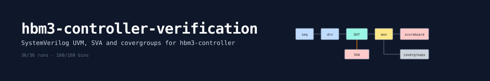

# hbm3-controller-verification

SystemVerilog UVM verification for
[hbm3-controller](https://github.com/smitarekar/hbm3-controller), an HBM3 memory
controller.

## What is in it

- **UVM environment** on Accellera uvm-core: AXI agent (driver, monitor, sequencer),
  PHY command monitor, scoreboard, coverage collector, 11 sequences, 12 tests
- **Scoreboard** that handles posted writes and reordering: a read can return any
  value that was legal at the time it was issued
- **SVA**: 31 assertions (175 instances) for every JEDEC timing rule on the
  command bus, plus AXI handshake rules
- **Functional coverage**: 6 SystemVerilog covergroups (commands per bank, command
  spacing, refresh, scheduler state, burst shapes)
- **Formal**: the timing engine is proved equal to an independent reference model
  (Yosys + ABC)
- **Mutation testing**: 16 realistic bugs planted in the RTL to check the checkers

## Results

| | |
|---|---|
| Regression | 36/36 runs pass (12 tests x 3 seeds) |
| Assertions | 0 failures |
| Coverage | 160/160 bins merged across the regression |
| Mutation testing | 16/16 planted bugs caught |
| Formal | timing engine proved for all reachable states |

## Run it

Needs Verilator 5.x and Python 3. Clone this next to `hbm3-controller`.

```sh
make build                     # first run fetches and patches uvm-core
make run TEST=hbm_full_test
make regress SEEDS="1 2 3"     # all tests, merged coverage report
python3 scripts/mutate.py      # mutation testing
make formal                    # needs sv2v, yosys, yosys-abc
```

## Layout

```text
tb/        interfaces, SVA, top level
tb/uvm/    UVM classes: driver, monitors, scoreboard, coverage, sequences, tests
formal/    formal proof of the timing engine
scripts/   regression, coverage merge, mutation testing
```

## License

MIT
